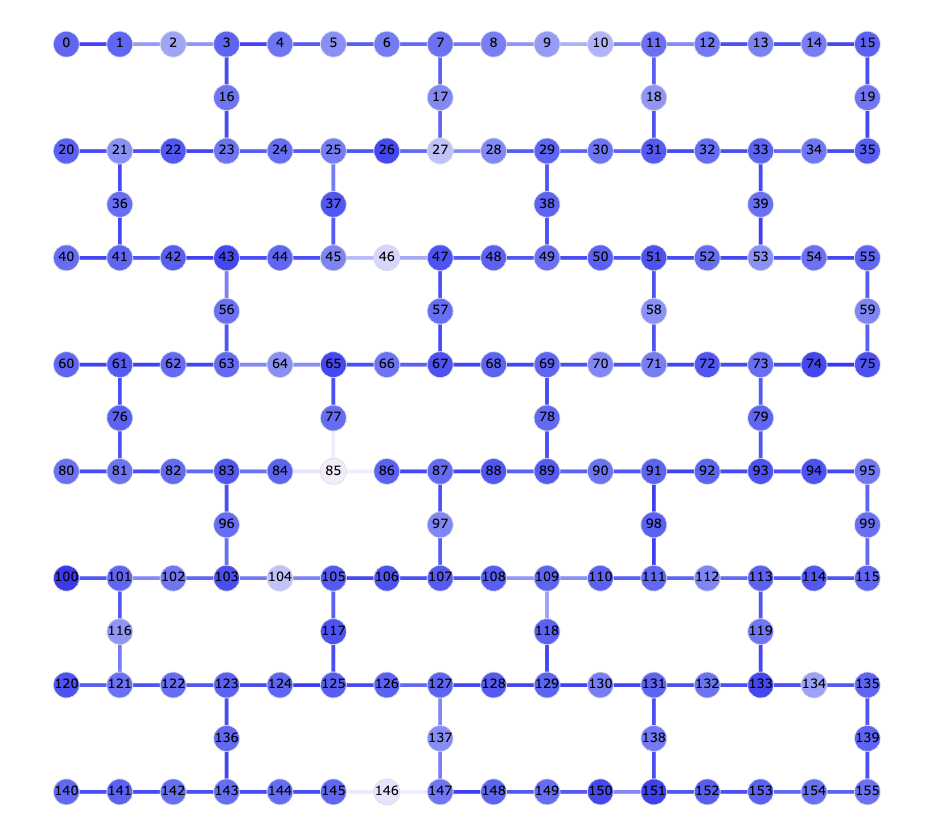
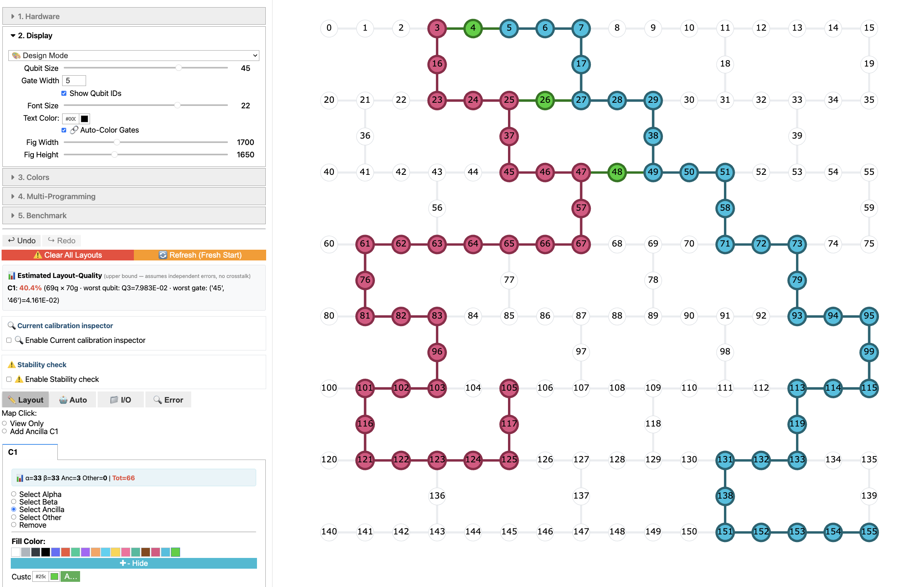

# I-QMapper

**Interactive, noise-aware qubit layout selection for IBM Quantum hardware — see your device, understand its errors, and place your circuit where it will actually run well.**

[](https://github.com/mbazayeva/i-qmapper/actions/workflows/tests.yml)
[](https://www.python.org/downloads/)
[](LICENSE)
[](https://arxiv.org/abs/2606.27508)

I-QMapper is presented in the paper *I-QMapper: Error-Aware Layout Optimization and
Device Diagnostics for NISQ Hardware* (Bazayeva & Merz,
[arXiv:2606.27508](https://arxiv.org/abs/2606.27508)). The repository tracks
development beyond the arXiv version.


**Contents:**
[Why](#why) ·
[Features](#features) ·
[Requirements](#requirements) ·
[Installation](#installation) ·
[Set up your IBM Quantum account](#set-up-your-ibm-quantum-account) ·
[Quickstart](#quickstart) ·
[Tutorial](TUTORIAL.md) ·
[How it works](#how-it-works) ·
[Extending to other vendors](#extending-to-other-vendors) ·
[Project layout](#project-layout) ·
[Limitations](#limitations--caveats) ·
[License & Citing](#license-credits--citing)

---

## Why

On NISQ hardware, *where* you place a circuit matters as much as *what* you run:
gate errors, readout errors, and coherence times vary across the chip and **drift
over time**. Today you either eyeball calibration tables by hand or trust an
automated layout pipeline you can't see into. I-QMapper closes that gap: an
interactive Jupyter tool where the device, its calibration data, its history, and
your layout live in one view — so every placement decision is **visible,
inspectable, and reproducible**.

## Features

- 🗺️ **Live error heatmaps** on the real device topology — readout, CZ error,
  coherence, and more, straight from current calibration data.
- 🕰️ **Time travel** — intraday snapshots, multi-day history, and **delta views**
  that show what drifted since yesterday (or since any reference you pick).
- 📈 **Stability Check** — don't just pick the best qubits *today*; see which
  qubits *stay* good across a 7/14/30-day window.
- 🎯 **Two operating modes** — a general-purpose mode for arbitrary circuits, and
  a dedicated mode for the **LUCJ ansatz** (quantum chemistry), with one-click
  auto-placement on heavy-hex topologies.
- 🏆 **Layout scoring & ranking (LQS)** — an error-aware quality score to compare
  candidate layouts before spending QPU time.
- 📦 **Import & export** — import layouts from JSON / `.npy` / QPY; export
  publication-ready PNGs, time-lapse GIF/MP4 of calibration
  history, full session save/restore, and generated Qiskit code for your chosen
  layout.
- 🔒 **Local-first** — your IBM Quantum credentials never leave your machine; the
  tool talks to IBM through your own locally saved `QiskitRuntimeService` account.

## Requirements

- Python **3.10+**
- An [IBM Quantum](https://quantum.ibm.com) account with a saved
  `QiskitRuntimeService` credential (see
  [Set up your IBM Quantum account](#set-up-your-ibm-quantum-account))
- JupyterLab or Jupyter Notebook

## Installation

```bash
# core
pip install -e .

# core + PNG export (adds kaleido)
pip install -e ".[png]"

# core + PNG + time-lapse GIF/MP4 (adds imageio, imageio-ffmpeg)
pip install -e ".[png,timelapse]"

# development (test suite)
pip install -e ".[dev]"
```

## Set up your IBM Quantum account

I-QMapper uses the credentials you save locally with `qiskit-ibm-runtime` —
it never asks for, stores, or transmits your token itself. One-time setup:

```python
from qiskit_ibm_runtime import QiskitRuntimeService

QiskitRuntimeService.save_account(
    channel='ibm_quantum_platform',
    token='YOUR_TOKEN',
    instance='YOUR_CRN',
    set_as_default=True,    # make this your default credential
    overwrite=True,
)
```

Find your token and instance CRN on the
[IBM Quantum Platform](https://quantum.ibm.com) dashboard.

**Multiple accounts / instances.** You can save one credential as your
**default** and give the others a `name=` — for example a premium instance as
the default, and another instance (e.g. a local QPU) you switch to on demand:

```python
# premium instance — saved as the default (used when no name is selected)
QiskitRuntimeService.save_account(
    channel='ibm_quantum_platform',
    token='YOUR_TOKEN',
    instance='PREMIUM_CRN',
    set_as_default=True,
    overwrite=True,
)

# another instance (e.g. a local QPU) — saved under a name, picked explicitly
QiskitRuntimeService.save_account(
    channel='ibm_quantum_platform',
    token='YOUR_TOKEN',
    instance='OTHER_CRN',
    name='my_backend',
    overwrite=True,
)
```

In I-QMapper's **account selector**, the default credential is used unless
you pick a named one — switch between them anytime without re-entering
anything.

## Quickstart

In a notebook cell:

```python
from iqmapper import run
run()
```

This opens the sidebar UI. Pick **IBM Quantum**, choose your saved account, pick
a backend, select the ansatz mode, and click **Connect & Launch**. From there
you can place qubits by hand, auto-place a LUCJ layout, compare candidates by
score, inspect calibration history, and export everything you see.

**New here? Follow the step-by-step [Tutorial](TUTORIAL.md).**

|  |  |
|:--:|:--:|
| *Live error heatmap* | *Delta view: what drifted since the reference* |
|  |  |
| *Stability check over a 14-day window* | *The full editor: layout, scoring, controls* |

## How it works

<details>
<summary><b>Architecture in one paragraph</b> — click to expand</summary>
<br>

The Python kernel is the auth and data layer: calibration data is fetched through
your locally saved IBM account, cached per-user on disk, and rendered with Plotly
inside ipywidgets panels. Every analysis (scoring, stability, delta) runs on the
cached snapshots — so browsing history and comparing layouts costs no QPU time
and no extra API calls. For a module-by-module tour, see
[CODE_OVERVIEW.md](CODE_OVERVIEW.md).

**Where your data lives:**

| What | Where |
|---|---|
| Calibration cache | macOS `~/Library/Caches/iqmapper` · Linux `~/.cache/iqmapper` (or `$XDG_CACHE_HOME/iqmapper`) · Windows `%LOCALAPPDATA%\iqmapper\Cache` |
| Cache override | Set the `IQMAPPER_CACHE_DIR` environment variable to relocate it |
| Sessions & style presets | `.iqmapper_sessions/` inside the directory your notebook runs from |

The cache is safe to delete at any time — the tool recreates it and refetches
on demand. Your IBM credentials are **not** stored by I-QMapper at all; they
live in your own `qiskit-ibm-runtime` account store.

</details>

## Extending to other vendors

<details>
<summary><b>How the vendor dispatch works</b> — click to expand</summary>
<br>

Backend loading goes through an explicit dispatch table
(`_VENDOR_LOADERS` in `iqmapper/connection.py`). Adding a provider means
implementing one loader with the same signature and registering it — the UI,
scoring, and visualization layers are vendor-agnostic. IBM Quantum is the
provider shipped today.

</details>

## Project layout

<details>
<summary><b>Repository structure</b> — click to expand</summary>
<br>

```
iqmapper/
├── connection.py     # account loading, vendor dispatch, backend selection
├── data.py           # calibration fetch + per-user cache
├── plot.py           # device graph & heatmap rendering
├── auto_lucj.py      # LUCJ auto-placement + layout error scoring
├── stability.py      # multi-day stability analysis
├── state.py          # session state, undo/redo, (de)serialization
├── export/           # scoring (LQS), layout I/O, codegen, PNG/analysis export
└── ui/               # ipywidgets panels (builder, time, history, analysis, …)
tests/                # 183 tests, offline, no QPU required
```

For a guided tour of the modules and data flow, see
[CODE_OVERVIEW.md](CODE_OVERVIEW.md).

</details>

## Limitations & caveats

<details>
<summary><b>What this tool is not</b> — click to expand</summary>
<br>

- Calibration data is as fresh as IBM's calibration cycle; the tool shows you
  *reported* device quality, which is a strong prior — not a guarantee — of run
  quality.
- The LQS score is a first-order heuristic for *relative* layout comparison, not
  an absolute fidelity prediction.
- Heavy-hex auto-placement currently targets IBM Heron/Nighthawk-class devices.

</details>

## License, Credits & Citing

I-QMapper is released under the [Apache License 2.0](LICENSE) (see also
[NOTICE](NOTICE)).

Parts of this project build on IBM open-source work: the auto-LUCJ layout scorer
was adapted from IBM code now incorporated in
[ffsim](https://github.com/qiskit-community/ffsim) (Sung *et al.*,
[arXiv:2605.03123](https://arxiv.org/abs/2605.03123)), and the layout-quality
estimator implements a cost function in the style of
[mapomatic](https://github.com/qiskit-community/mapomatic)
(Nation & Treinish, *PRX Quantum* **4**, 010327, 2023). The LUCJ ansatz is due to
Motta *et al.*, *Chem. Sci.* **14**, 11213–11227 (2023),
[doi:10.1039/D3SC02516K](https://doi.org/10.1039/D3SC02516K).

If you use I-QMapper in your research, please cite the I-QMapper paper
([arXiv:2606.27508](https://arxiv.org/abs/2606.27508)) — see
[CITATION.cff](CITATION.cff).
