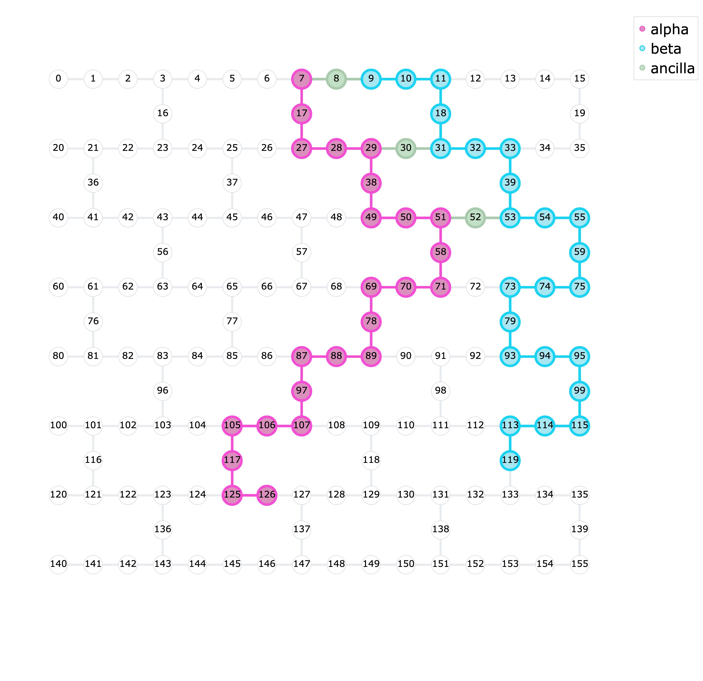
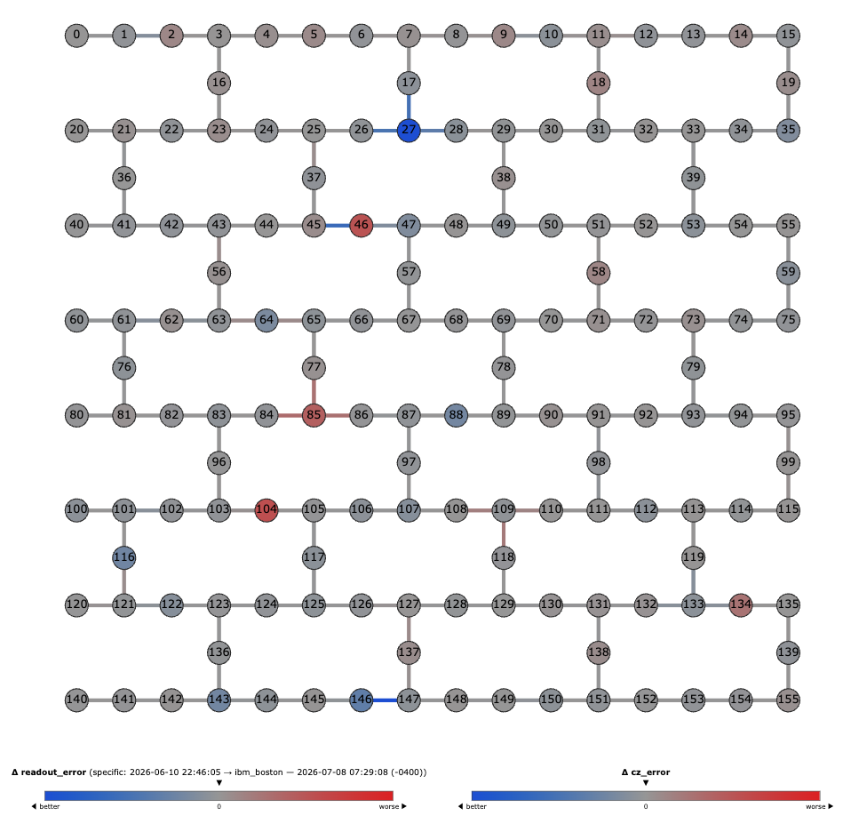
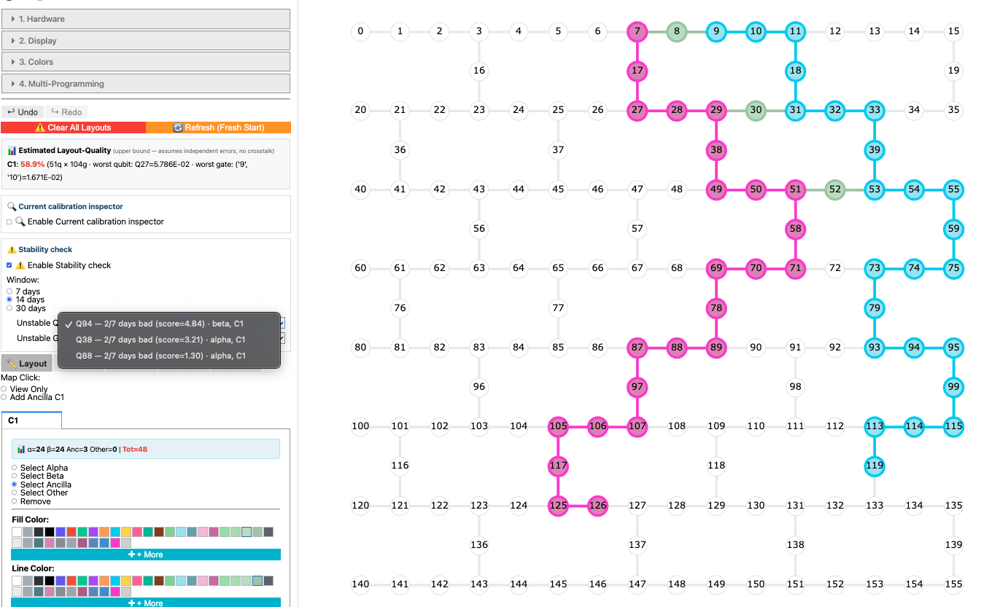

# I-QMapper

**Interactive, noise-aware qubit layout selection for IBM Quantum hardware — see your device, understand its errors, and place your circuit where it will actually run well.**

[](https://github.com/MIQuLab/i-qmapper/actions/workflows/tests.yml)
[](https://www.python.org/downloads/)
[](LICENSE)
[](https://arxiv.org/abs/2606.27508)

I-QMapper is presented in the paper *I-QMapper: Error-Aware Layout Optimization and
Device Diagnostics for NISQ Hardware* (Bazayeva & Merz,
[arXiv:2606.27508](https://arxiv.org/abs/2606.27508)). 



**Contents:**
[Why](#why) ·
[Features](#features) ·
[Requirements](#requirements) ·
[Installation](#installation) ·
[Set up your IBM Quantum account](#set-up-your-ibm-quantum-account) ·
[Quickstart](#quickstart) ·
[Tutorial](TUTORIAL.md) ·
[How it works](#how-it-works) ·
[Extending to other vendors](#extending-to-other-vendors) ·
[Project layout](#project-layout) ·
[Limitations](#limitations--caveats) ·
[License & Citing](#license-credits--citing)

---

## Why

On NISQ hardware, *where* you place a circuit matters as much as *what* you run:
gate errors, readout errors, and coherence times vary across the chip and **drift
over time**. Today you either eyeball calibration tables by hand or trust an
automated layout pipeline you can't see into. I-QMapper closes that gap: an
interactive Jupyter tool where the device, its calibration data, its history, and
your layout live in one view — so every placement decision is **visible,
inspectable, and reproducible**.

## Features

- 🗺️ **Live error heatmaps** on the real device topology — readout, CZ error,
  coherence, and more, straight from current calibration data.
- 🕰️ **Time travel** — intraday snapshots, multi-day history, and **delta views**
  that show what drifted since yesterday (or since any reference you pick).
- 📈 **Stability Check** — don't just pick the best qubits *today*; see which
  qubits *stay* good across a 7/14/30-day window.
- 🎯 **Two operating modes** — a general-purpose mode for arbitrary circuits, and
  a dedicated mode for the **LUCJ ansatz** (quantum chemistry), with one-click
  auto-placement on heavy-hex topologies.
- 🏆 **Layout scoring & ranking (LQS)** — an error-aware quality score to compare
  candidate layouts before spending QPU time.
- 📦 **Import & export** — import layouts from JSON / `.npy` / QPY; export
  publication-ready PNGs, time-lapse GIF/MP4 of calibration
  history, full session save/restore, and generated Qiskit code for your chosen
  layout.
- 📡 **Real-time benchmarking (optional)** — re-measure your candidate qubits and
  edges on the live device and re-rank against what the hardware is doing *now*,
  not what it reported this morning. Opt-in, tiered and costed up front; see
  [Real-time benchmarking](#real-time-benchmarking-optional).
- 🔒 **Local-first** — your IBM Quantum credentials never leave your machine; the
  tool talks to IBM through your own locally saved `QiskitRuntimeService` account.

## Requirements

- Python **3.10+**
- An [IBM Quantum](https://quantum.ibm.com) account with a saved
  `QiskitRuntimeService` credential (see
  [Set up your IBM Quantum account](#set-up-your-ibm-quantum-account))
- JupyterLab or Jupyter Notebook

## Installation

Install from [PyPI](https://pypi.org/project/i-qmapper/):

```bash
pip install i-qmapper
```

Optional extras, combinable (e.g. `"i-qmapper[png,timelapse]"`):

```bash
pip install "i-qmapper[png]"         # publication PNG export (kaleido)
pip install "i-qmapper[timelapse]"   # time-lapse GIF/MP4 export (imageio, imageio-ffmpeg)
pip install "i-qmapper[benchmark]"   # real-time benchmarking (qiskit-experiments)
```

### From source (development)

```bash
git clone https://github.com/MIQuLab/i-qmapper
cd i-qmapper
pip install -e ".[dev]"
pytest -q
```

## Set up your IBM Quantum account

I-QMapper uses the credentials you save locally with `qiskit-ibm-runtime` —
it never asks for, stores, or transmits your token itself. One-time setup:

```python
from qiskit_ibm_runtime import QiskitRuntimeService

QiskitRuntimeService.save_account(
    channel='ibm_quantum_platform',
    token='YOUR_TOKEN',
    instance='YOUR_CRN',
    set_as_default=True,    # make this your default credential
    overwrite=True,
)
```

Find your token and instance CRN on the
[IBM Quantum Platform](https://quantum.ibm.com) dashboard.

**Multiple accounts / instances.** You can save one credential as your
**default** and give the others a `name=` — for example a premium instance as
the default, and another instance (e.g. a local QPU) you switch to on demand:

```python
# premium instance — saved as the default (used when no name is selected)
QiskitRuntimeService.save_account(
    channel='ibm_quantum_platform',
    token='YOUR_TOKEN',
    instance='PREMIUM_CRN',
    set_as_default=True,
    overwrite=True,
)

# another instance (e.g. a local QPU) — saved under a name, picked explicitly
QiskitRuntimeService.save_account(
    channel='ibm_quantum_platform',
    token='YOUR_TOKEN',
    instance='OTHER_CRN',
    name='my_backend',
    overwrite=True,
)
```

In I-QMapper's **account selector**, the default credential is used unless
you pick a named one — switch between them anytime without re-entering
anything.

## Quickstart

In a notebook cell:

```python
from iqmapper import run
run()
```

This opens the sidebar UI. Pick **IBM Quantum**, choose your saved account, pick
a backend, select the ansatz mode, and click **Connect & Launch**. From there
you can place qubits by hand, auto-place a LUCJ layout, compare candidates by
score, inspect calibration history, and export everything you see.

**New here? Follow the step-by-step [Tutorial](TUTORIAL.md).**

|  |  |
|:--:|:--:|
| *Live error heatmap* | *Delta view: what drifted since the reference* |
|  |  |
| *Stability check over a 14-day window* | *The full editor: layout, scoring, controls* |

## How it works

<details>
<summary><b>Architecture in one paragraph</b> — click to expand</summary>
<br>

The Python kernel is the auth and data layer: calibration data is fetched through
your locally saved IBM account, cached per-user on disk, and rendered with Plotly
inside ipywidgets panels. Every analysis (scoring, stability, delta) runs on the
cached snapshots — so browsing history and comparing layouts costs no QPU time
and no extra API calls. For a module-by-module tour, see
[CODE_OVERVIEW.md](CODE_OVERVIEW.md).

**Where your data lives:**

| What | Where |
|---|---|
| Calibration cache | macOS `~/Library/Caches/iqmapper` · Linux `~/.cache/iqmapper` (or `$XDG_CACHE_HOME/iqmapper`) · Windows `%LOCALAPPDATA%\iqmapper\Cache` |
| Cache override | Set the `IQMAPPER_CACHE_DIR` environment variable to relocate it |
| Sessions & style presets | `.iqmapper_sessions/` inside the directory your notebook runs from |

The cache is safe to delete at any time — the tool recreates it and refetches
on demand. Your IBM credentials are **not** stored by I-QMapper at all; they
live in your own `qiskit-ibm-runtime` account store.

</details>

## Real-time benchmarking (optional)

I-QMapper normally ranks layouts on the calibration IBM *reports*, which is
refreshed about once a day. Qubits drift inside that window, so a layout chosen
at 14:00 can sit on a qubit that degraded at 11:00. The Benchmark section in the
**Auto** tab re-measures the hardware and feeds the result back as a "measured"
calibration epoch — the heatmap, LQS, candidate ranking and exports all read it
exactly as they read the reported one.

It lives in the sidebar as **5. Benchmark** — beside Hardware rather than inside
the Auto search, because benchmarking is a property of the backend: it serves
hand-placed layouts as readily as swept ones, every circuit slot, the whole QPU,
and the second panel in inter-QPU mode.

Install the extra first:

```bash
pip install "i-qmapper[benchmark]"
```

Three levels, each measuring only what it needs to:

| Level | What it measures | Scope | Rough QPU cost |
|-------|------------------|-------|----------------|
| **1 Quick readout** | Readout assignment error | Candidate qubits | Seconds |
| **2 Targeted** | Level 1 + two-qubit RB | Candidate qubits and edges | Tens of seconds |
| **3 Full chip** | T1, T2 (Hahn), readout, 1Q RB, 2Q RB | Whole device | ~4 minutes |

Pick what to measure with **Targets**: the currently placed layout(s) across
every circuit slot, the last sweep's top candidates, the whole QPU, or an
explicit qubit list. Levels 1 and 2 are targeted, which is why they are cheap;
Level 3 reproduces the full-chip suite from IBM's "Real-time benchmarking for
qubit selection" tutorial.

Worth knowing: **Level 1 does not get more expensive as you measure more
qubits** — readout is two circuits whatever the width — so `Whole QPU` x Level 1
is the cheap way to refresh the readout heatmap across the device. Levels 2 and
3 scale with the number of edges and are not cheap.

In inter-QPU mode a **QPU 1 | QPU 2** selector appears; everything — targets,
cost, run, the resulting epoch and its cache file — then applies to whichever
device is selected.

**It is never automatic.** Nothing benchmarks on connect, on a timer, or inside
the multi-QPU scan. A run happens only when you click **Run benchmark**, and the
estimated cost is on screen before you can click it.

**Mind your plan.** The cost estimates are wall-clock QPU seconds, and on an
Open-plan account a Level 3 run can consume a large part of a monthly
allowance. I-QMapper detects your plan where it can and assumes the Open plan
when it cannot, so Level 2 warns and Level 3 requires an explicit
acknowledgement. The estimate itself is calibrated from a single published
figure — treat it as the right order of magnitude, not a quote.

### Trusting the numbers

Randomized benchmarking and the provider's calibration are *different
estimators* of the same quantity. A two-qubit Clifford contains roughly 1.5
two-qubit gates and 8-10 single-qubit ones, so the RB analysis is given the
measured single-qubit error rates and subtracts them; without that step the
single-qubit error lands on the two-qubit gate and every edge reads a few times
worse than reported.

After every run I-QMapper compares the measured values with the reported ones
per property and shows the result (`cz_error: ×1.1 median vs reported · 3 of
351 >2× worse`). If a property's median is more than 2× away in either
direction, that is a systematic offset rather than drift — a whole chip does not
degrade uniformly overnight — and the epoch is applied in **relative mode**:
each value is rescaled so the median matches the reported one, which removes the
offset while preserving every per-element ratio. Tick **Apply absolute values**
to use the raw numbers instead.

This matters because the point of benchmarking is the **outliers**: a coupler
that has collapsed since the last calibration shows up as 10× worse than its
neighbours, and that signal survives rescaling intact. The absolute level is
what you should not read too closely.

**Calibration check** runs a handful of edges twice — once with the pairs
driven in parallel, once one at a time — and prints both against the reported
values. If both come back offset it is the estimator; if only the parallel run
is offset it is crosstalk between simultaneously driven pairs.

A run reports what it actually measured: `measured 156/156 qubits` when complete,
`⚠ partial` when some elements failed to fit, and `⚠ no usable measurements —
reported epoch kept` when nothing came back. A rejected or failed job shows IBM's
own error text and the job ids. Nothing is ever labelled "measured" unless it was.

Measured values replace reported ones only for the elements actually measured;
everything else keeps its reported value, and the calibration label tells you
which epoch you are looking at. Any experiment or fit that fails falls back to
the reported value for that element with a notice, never a crash.

## Understanding the messages

The interface says what happened and what to do; the explanations live here.
Tooltips that end with `· README: <name>` point at the matching entry below.

### Search cap

The exhaustive engine enumerates candidate layouts and stops at this many. On
a large chip there can be far more layouts than the cap, so it is normally
reached at low ancilla counts. When it is, the notices bar says so — raise the cap for a
more thorough (slower) search, or leave it and rely on diverse enumeration.

### Diverse enumeration

With this on, the cap counts *distinct* candidates. During the search a layout
that overlaps one already kept by more than 80% of its qubits, and does not
score better, is discarded without using a slot; one that scores better takes
its place. Without it the cap fills with near-copies of the first region the
search finds, and much of a large chip is never looked at. With it, similar
layouts don't use up the cap, so the sample spreads across the chip. It only
makes a difference where the cap is actually reached.

### Search engine

**Exhaustive** enumerates layouts that fit the template and only then asks how
good they are — thorough, but blind to calibration until the end. **Guided**
grows each layout using the calibration as it goes and polishes the finalists.
Guided is a heuristic: it can miss the best layout that exhaustive would find,
so it stays opt-in until the comparison harness says otherwise.

**Hybrid** uses guided where exhaustive is capped (few ancillas: so many
layouts fit that exhaustive only ranks a sample) and exhaustive where it is
complete (many ancillas: few layouts fit, and all of them are checked). Set
**Guided up to k** to the highest ancilla count where guided does at least as
well as exhaustive in the engine comparison (`python -m iqmapper.evaluation`).
The status line names the split, e.g. `engine: hybrid (guided ≤ k1)`; the
`refined 2/5` tally counts the guided finalists the polish improved.

### Multi-circuit planner

**Sequential** places circuits one at a time, each on the best region left.
It is fast but short-sighted: the first circuit can take a region that leaves
the next one only a poor spot, or none at all.

**Joint** keeps several partial plans instead of one. After each circuit it
tries **Candidates per circuit** layouts on every plan it holds and keeps the
best **Plans kept** of them. It also builds the sequential plan and returns
whichever is better, so it is never worse — only slower. It searches with the
selected search engine (Sequential always uses exhaustive). While it runs, the
status shows `joint plan · up to N searches`, the worst case.

When it finishes, `joint plan · +X% vs sequential · N searches` compares the
two plans' totals (the product of each circuit's LQS) and counts the searches
actually run. If the joint plan fits more circuits than sequential could, it
says `places 3 vs 2 sequential` instead, since a total over more circuits is
not comparable.

**Boundary penalty** matters only at **Buffer qubits: 0**. With a buffer of 1
or more, two circuits can never touch. At 0 they can sit side by side, and a
coupler between them carries gates of one circuit next to idle qubits of the
other: crosstalk the LQS does not model. `shared couplers: 47–48` lists such
couplers. Each one multiplies the plan's score by `1 − penalty`, so a penalty
of 0.5 makes the planner prefer a plan without them when one exists; 0 only
reports them.

### Prefer diverse regions

The top half of each candidate list is always the best-scoring layouts. The
second half is allowed to prefer layouts on other parts of the chip, so you
get alternatives rather than five variations on one position. It never demotes
a better layout.

### Quality floor

Qubits whose readout error is far above the device average are dropped from
the search before it starts, measured in standard deviations above the mean.
Set it to 0 to disable. This is about excluding obviously broken qubits, not
fine-tuning.

### Levels

How much of the device a benchmark measures.

- **1 — readout only.** Two circuits regardless of how many qubits you target,
  so it costs the same for three qubits as for the whole chip. Seconds.
- **2 — adds two-qubit gates** on the target edges, plus the single-qubit
  measurements needed to interpret them. Tens of seconds.
- **3 — whole chip**: coherence times, readout, single- and two-qubit gates.
  About four minutes of quantum time.

### Targets

What a benchmark measures: the layouts currently placed on the map, the last
sweep's best candidates, the whole device, or a list of qubits you type. Level
1 on the whole device is the cheap way to refresh the readout colours, because
its cost does not grow with the number of qubits.

### Relative mode

Benchmarking and the provider's calibration are different ways of measuring
the same thing, and they do not always agree on the absolute scale. After each
run the measured values are compared with IBM's. If a property's median is
more than twice IBM's, or less than half, that is treated as a difference of
method rather than a change in the device — a whole chip does not degrade
uniformly overnight — and the values are rescaled so their median matches
IBM's while the differences *between* qubits are kept exactly.

That is what matters in practice: a coupler that has failed still shows up ten
times worse than its neighbours. Tick **Apply absolute values** to use the raw
measurements instead, for example when you are investigating the scale itself.

### Calibration check

Measures six edges twice in one session — first with all pairs driven together,
then one pair at a time — and compares both against IBM's values.

- **Both arms offset the same way** → estimator bias: the analysis is
  attributing single-qubit error to the two-qubit gate.
- **Only the parallel arm offset** → crosstalk: driving neighbouring pairs
  simultaneously is inflating the error.
- **Both close to IBM's values** → the measurements agree; nothing to correct.

It does not change the calibration in use; it measures the instrument.

### Delta references

In delta view each calibration is compared against a reference. **First** uses
the first calibration in the sequence, so you see cumulative drift from a
starting point. **Previous** uses the one before it, so you see step-by-step
change as you move the slider; at the first position there is nothing to
compare against.

### Offline mode

A session restored without a backend connection. Layout editing, scoring
against the saved calibration, and export all work. Anything that needs live
data — delta view, calibration history, refreshing the error map — waits until
you connect a backend from the Hardware section.

### LQS

Layout Quality Score: an estimate of how well a circuit would run on a given
set of qubits, combining the readout and gate errors of every qubit and
coupling it uses. It is the same number the Estimated Layout-Quality box
shows. A `(template)` suffix means the full calculation was unavailable and a
simpler heuristic was used instead.

## Extending to other vendors

<details>
<summary><b>How the vendor dispatch works</b> — click to expand</summary>
<br>

Backend loading goes through an explicit dispatch table
(`_VENDOR_LOADERS` in `iqmapper/connection.py`). Adding a provider means
implementing one loader with the same signature and registering it — the UI,
scoring, and visualization layers are vendor-agnostic. IBM Quantum is the
provider shipped today.

</details>

## Project layout

<details>
<summary><b>Repository structure</b> — click to expand</summary>
<br>

```
iqmapper/
├── connection.py     # account loading, vendor dispatch, backend selection
├── data.py           # calibration fetch + per-user cache
├── plot.py           # device graph & heatmap rendering
├── auto_lucj.py      # LUCJ auto-placement + layout error scoring
├── ancilla_sweep.py, guided_search.py, engine_select.py, multi_sweep.py,
│   joint_plan.py, qpu_scan.py …   # layout search engines and planners
├── benchmark.py      # opt-in real-time benchmarking
├── stability.py      # multi-day stability analysis
├── state.py          # session state, undo/redo, (de)serialization
├── export/           # scoring (LQS), layout I/O, codegen, PNG/analysis export
└── ui/               # ipywidgets panels (builder, time, history, analysis, …)
tests/                # offline, no QPU required — run with: python -m pytest -q
```

For a guided tour of the modules and data flow, see
[CODE_OVERVIEW.md](CODE_OVERVIEW.md).

</details>

## Limitations & caveats

<details>
<summary><b>What this tool is not</b> — click to expand</summary>
<br>

- Calibration data is as fresh as IBM's calibration cycle; the tool shows you
  *reported* device quality, which is a strong prior — not a guarantee — of run
  quality.
- The LQS score is a first-order heuristic for *relative* layout comparison, not
  an absolute fidelity prediction.
- Heavy-hex auto-placement currently targets IBM Heron/Nighthawk-class devices.

</details>

## License, Credits & Citing

I-QMapper is released under the [Apache License 2.0](LICENSE) (see also
[NOTICE](NOTICE)).

Parts of this project build on IBM open-source work: the auto-LUCJ layout scorer
was adapted from IBM code now incorporated in
[ffsim](https://github.com/qiskit-community/ffsim) (Sung *et al.*,
[arXiv:2605.03123](https://arxiv.org/abs/2605.03123)), and the layout-quality
estimator implements a cost function in the style of
[mapomatic](https://github.com/qiskit-community/mapomatic)
(Nation & Treinish, *PRX Quantum* **4**, 010327, 2023). The LUCJ ansatz is due to
Motta *et al.*, *Chem. Sci.* **14**, 11213–11227 (2023),
[doi:10.1039/D3SC02516K](https://doi.org/10.1039/D3SC02516K).

If you use I-QMapper in your research, please cite the I-QMapper paper
([arXiv:2606.27508](https://arxiv.org/abs/2606.27508)) — see
[CITATION.cff](CITATION.cff).
