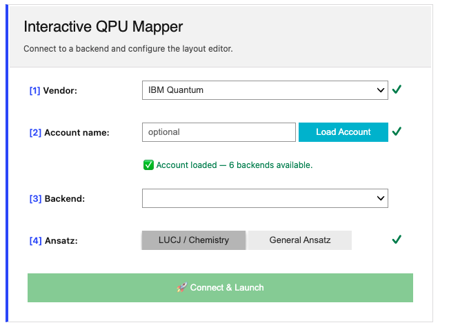
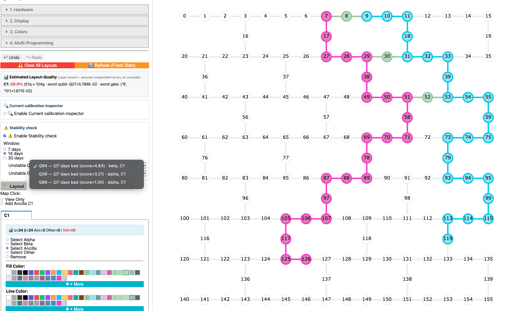

# Tutorial

A walkthrough from launch to an exported, calibration-aware layout. It assumes
the package is installed and an IBM Quantum credential is saved locally (see
[Installation](README.md#installation)).

Contents:
[1. Launch and connect](#1-launch-and-connect) ·
[2. Read the map](#2-read-the-map) ·
[3. Place a layout](#3-place-a-layout) ·
[4. Score and compare](#4-score-and-compare) ·
[5. Calibration history](#5-calibration-history) ·
[6. Stability check](#6-stability-check) ·
[7. Several circuits and several processors](#7-several-circuits-and-several-processors) ·
[8. Benchmark the device](#8-benchmark-the-device) ·
[9. Import, export and sessions](#9-import-export-and-sessions) ·
[10. Where your data lives](#10-where-your-data-lives)

## 1. Launch and connect

In a notebook cell:

```python
from iqmapper import run
run()
```

The sidebar opens. In section **1. Hardware**:

1. **Vendor** — IBM Quantum (the provider shipped today).
2. **Account** — every credential saved with `QiskitRuntimeService.save_account`
   is listed; the default credential is used unless a named one is selected.
3. **Load account** — connects through the credential and lists the backends
   the instance can access.
4. **Backend** — select a device and the ansatz mode (general-purpose or
   LUCJ), then **Connect & Launch**.

The device map appears. A 14-day calibration history loads in the background;
the Stability section shows a note until it is complete, and everything else is
available immediately.

<p align="center"></p>

## 2. Read the map

The main view is the device topology coloured by a calibration property.

- **Property selectors** — one for qubits, one for couplers: readout error,
  two-qubit gate error, T1, T2, gate length and the other properties the
  backend reports. Only properties with values on the connected device are
  listed.
- **Hover** a qubit or coupler for its calibrated values. A missing value reads
  "no data".
- **Colour bars** show the scale with the device median marked.
- With the default palette, light means low error and dark means high error;
  the palette can be changed in **3. Colors**.

<p align="center"></p>

## 3. Place a layout

- **By hand** — click qubits on the map to add them to, or remove them from,
  the current circuit. In LUCJ mode each qubit takes a role (α chain, β chain
  or ancilla bridge), shown in a distinct colour.
- **Automatically (LUCJ mode)** — set the number of spatial orbitals and
  select **Generate LUCJ Layout**. The search tries every ancilla count,
  scores each candidate on the current calibration, places the best one and
  lists the others in the **Layout** dropdown, ranked by LQS. Each entry ends
  with its origin: `E` (exhaustive search), `G` (guided search) or `E+G` (both).

Several circuits can be placed at once, each in its own colour; undo and redo
cover every placement action.

<p align="center"></p>

## 4. Score and compare

- **Estimated Layout-Quality** (sidebar) gives the layout quality score (LQS) of
  each placed circuit: a product of readout and two-qubit gate fidelities over
  exactly the qubits and couplers the circuit uses, with the qubit and coupler
  counts beside it. The definition is in the
  [user guide](docs/user-guide.md#lqs).
- **Rankings** (Error tab, Analysis) order qubits and couplers by error.

The score is intended for comparing layouts on the same processor; differences
between layouts are meaningful, the absolute value is not a fidelity
prediction.

<p align="center"></p>

## 5. Calibration history

The **Calibration** section selects which calibration the map shows:

- **Live** — the current calibration (default).
- **Snapshot** — a chosen past date and time.
- **Intraday** — one day, with a slider over its calibration updates.
- **Multi-day** — a date range, with a slider over the days.

**Delta** colours the map by the change relative to a reference calibration
(the first of the sequence, or the previous one): blue improved, red degraded.
It shows at a glance what has drifted since the layout was chosen.

<p align="center"></p>

## 6. Stability check

In the **Stability check** card, enable the check and select a window of 7, 14
or 30 days. For the qubits and couplers of the placed layout, the cached
history is analysed and each element is flagged as stable or volatile. If the
selected window is longer than the fetched history, the header says so; more
days can be fetched from the Multi-day mode of the Calibration section.

The stability filter, in the Auto-LUCJ options, excludes volatile qubits from
the automatic search.

<p align="center"></p>

## 7. Several circuits and several processors

With **4. Multi-Programming** enabled, the Auto-LUCJ panel gains a **Multi**
tab:

- Enter the orbital counts of the circuits, e.g. `8, 8, 6`, and a **Buffer**
  of idle qubits to keep between them, then **Generate Multi-Circuit**. The
  circuits are planned together; the **Plans** dropdown lists the best
  complete plans and places all circuits of the selected one.
- **Scan batch on all QPUs** plans the same circuits on every accessible
  backend with that backend's own calibration and ranks the results;
  **Open on QPU 2** connects the selected backend as a second processor and
  places the plan on it.

The single-circuit equivalent, **Scan all QPUs**, is in the **Single** tab.
Details of the planner and the scans are in the
[user guide](docs/user-guide.md#multi-circuit-planner).

<p align="center"></p>

## 8. Benchmark the device

The sections above rank layouts on the calibration the provider reports,
which can be up to a day old. Section **5. Benchmark** measures the hardware
now. It requires the `benchmark` extra (`pip install "i-qmapper[benchmark]"`);
without it the section shows the install hint and stays disabled.

1. **Targets** — the current layouts (every circuit slot), the last search's
   best candidates, the whole QPU, or a typed list of qubits.
2. **Level** — 1 measures readout only (seconds; its cost does not grow with
   the number of qubits), 2 adds two-qubit randomized benchmarking on the
   target couplers, 3 measures the whole processor including coherence times
   (about four minutes).
3. The summary line states how many qubits and couplers will be measured, the
   estimated QPU time and the detected plan. On the Open plan, Level 2 warns
   and Level 3 requires an explicit acknowledgement.
4. **Run benchmark**.

When the run completes, the calibration label changes to the measured epoch,
e.g. `measured 14:32 (L2, 38q/44e)`, and the map, the LQS and the candidate
list use the measured values for the elements that were measured; all other
elements keep their reported values. A consistency line compares the
measurement with the reported calibration; a systematic offset is handled in
relative mode, and **Calibration check** distinguishes an estimator offset from
crosstalk. See [benchmark.md](docs/benchmark.md).

Nothing runs automatically: no benchmark starts on connect, on a timer or
during a scan.

<p align="center"></p>

## 9. Import, export and sessions

From the **I/O** section:

- **Layout JSON** — export the placed layouts, including LUCJ roles, and
  re-import them later or on another backend. Import also accepts `.npy`
  arrays of qubit indices and QPY circuits.
- **PNG** — the current view with legend and colour bars (requires the `png`
  extra).
- **Time-lapse** — after fetching intraday or multi-day history, an animated
  GIF or MP4 of the calibration over time (requires the `timelapse` extra).
- **Qiskit code** — code that applies the chosen layout in a Qiskit workflow.
- **Export Session / Load Session** — the whole state (layouts, colours, zoom,
  backend context) in one file, to resume later or to share. Style presets can
  be saved and reused independently of sessions.

Messages in the interface that end with `· Guide: <entry>` refer to the entry of
that name in the [user guide](docs/user-guide.md).

## 10. Where your data lives

| Data | Location |
|---|---|
| Calibration cache | macOS `~/Library/Caches/iqmapper` · Linux `~/.cache/iqmapper` (or `$XDG_CACHE_HOME/iqmapper`) · Windows `%LOCALAPPDATA%\iqmapper\Cache` |
| Cache override | environment variable `IQMAPPER_CACHE_DIR`, set before launching |
| Log file | `iqmapper.log` in the user log directory (e.g. `~/Library/Logs/iqmapper` on macOS) |
| Sessions and style presets | `.iqmapper_sessions/` in the directory the notebook runs from |
| IBM credentials | Not stored by I-QMapper; they live in the `qiskit-ibm-runtime` account store (`~/.qiskit/qiskit-ibm.json`) |

The cache is what makes history, delta views and the stability check free of
repeated API calls. It can be deleted at any time; the tool recreates it on
demand.
