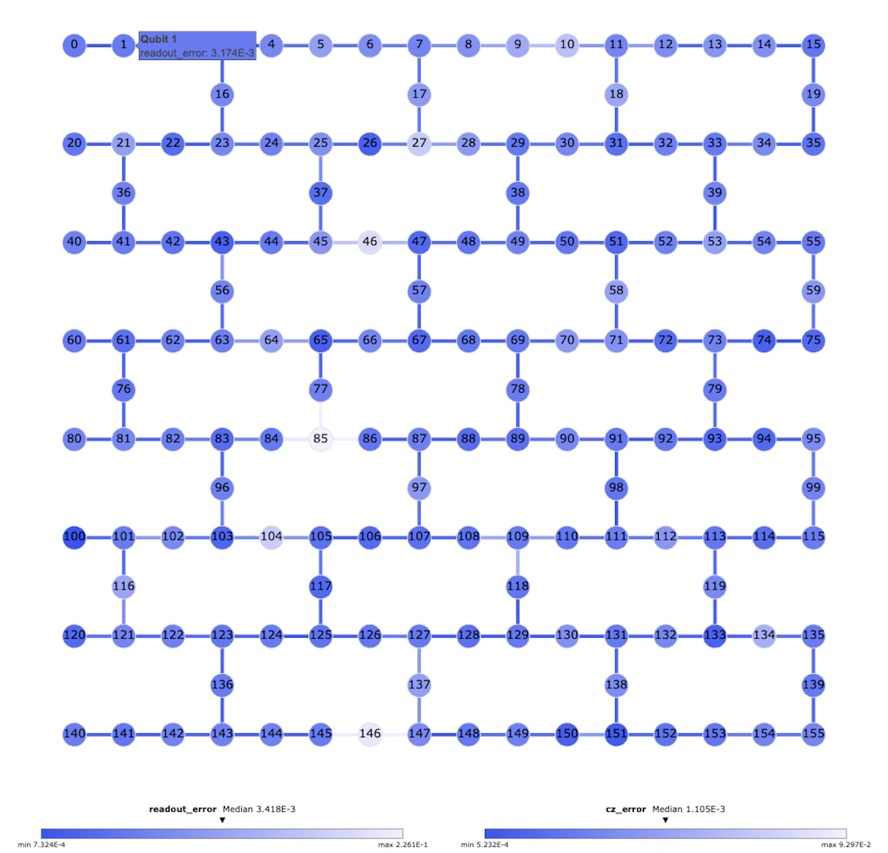
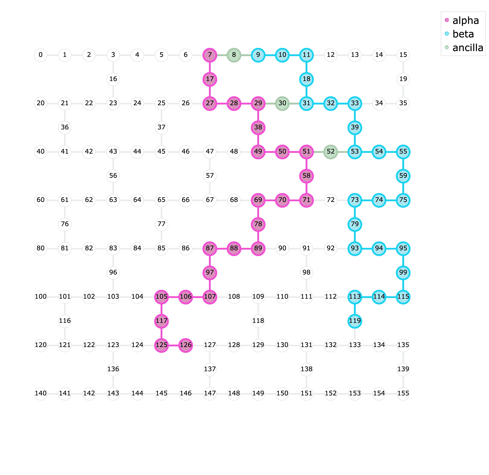
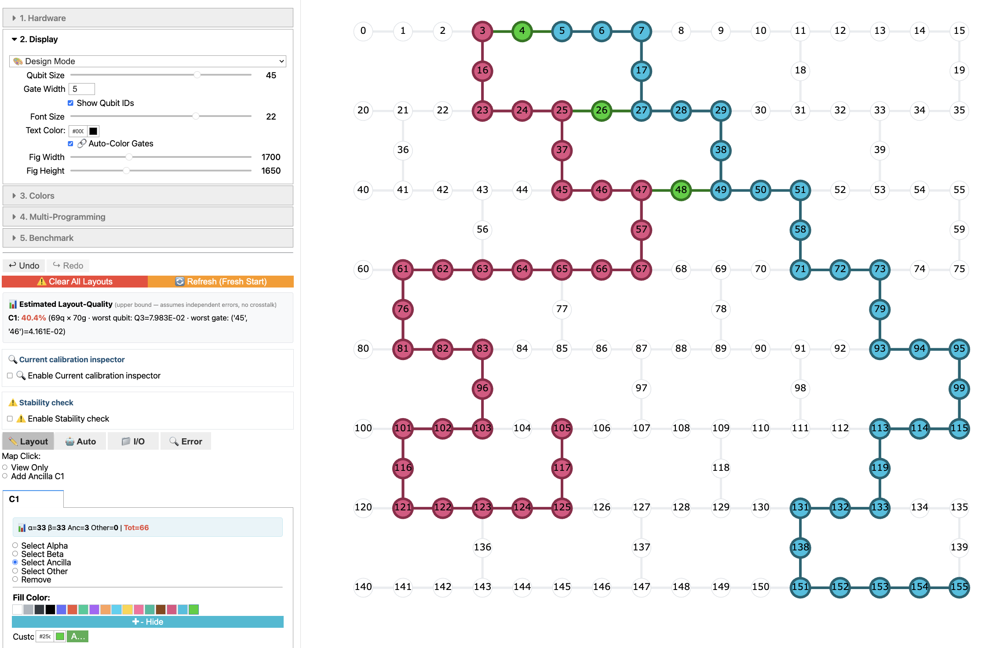
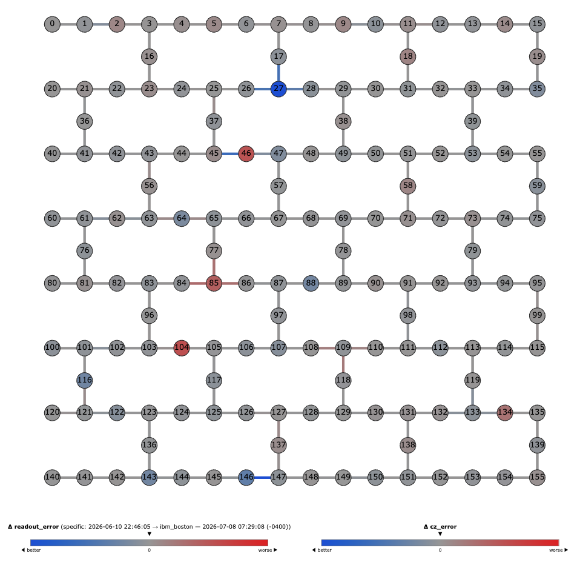

# I-QMapper — Tutorial

A step-by-step walkthrough from zero to an exported, error-aware layout.
Prerequisites: [Installation](README.md#installation) and
[account setup](README.md#set-up-your-ibm-quantum-account) from the README.

**Steps:**
[1. Launch & connect](#1-launch--connect) ·
[2. Read the map](#2-read-the-map) ·
[3. Place a layout](#3-place-a-layout) ·
[4. Score & compare](#4-score--compare) ·
[5. Travel in time](#5-travel-in-time) ·
[6. Check stability](#6-check-stability) ·
[7. Benchmark the live device](#7-benchmark-the-live-device-optional) ·
[8. Import & export](#8-import--export) ·
[9. Save your session](#9-save-your-session) ·
[10. Where your data lives](#10-where-your-data-lives)

---

## 1. Launch & connect

In a notebook cell:

```python
from iqmapper import run
run()
```

The sidebar opens. In order:

1. **Vendor** — pick *IBM Quantum* (the provider shipped today).
2. **Account** — the dropdown lists every credential you saved with
   `QiskitRuntimeService.save_account(..., name=...)`. This is how you switch
   between, say, a premium instance and an open one without re-entering
   anything.
3. **Load account** — the tool connects through your local credential and
   lists the backends your instance can access.
4. **Backend** — pick a device, choose the **ansatz mode** (general-purpose
   or LUCJ), and click **Connect & Launch**.

The device map appears, and a 14-day calibration history starts loading in the
background — you'll see a ⏳ note in the Stability section until it finishes
(everything else is usable immediately).


## 2. Read the map

The main view is the device topology with a live error heatmap:

- **Property selector** — switch what the colors mean: readout error, CZ/two-
  qubit gate error, T1/T2, gate length, and more. Qubit colors and edge colors
  are set independently.
- **Hover** any qubit or coupling to see its exact calibrated values.
- **Colorbars** at the bottom show the scale, with the device **median**
  marked — an instant sense of "is this qubit better or worse than typical".
- Light = good, dark = high error (with the default palette; you can restyle
  everything from the color picker).



## 3. Place a layout

Two ways:

- **By hand** — click qubits on the map to add/remove them from the current
  circuit's layout. In LUCJ mode, qubits get roles (α system / β system /
  ancilla bridges) with distinct colors.
- **Auto-place (LUCJ mode)** — one click runs the zig-zag placer, which scans
  the heavy-hex topology for the lowest-error chain using the current
  calibration data, and places the whole ansatz for you.

Multiple circuits can coexist, each with its own color; undo/redo covers every
placement action.



## 4. Score & compare

Open the **Analysis** panel:

- **LQS (Layout-Quality Score)** — an error-aware fidelity estimate for each
  placed circuit, computed from the readout and two-qubit errors of exactly
  the qubits and couplings you're using. Use it to compare candidate layouts
  *before* spending QPU time.
- **Rankings** — see alternative placements ordered by score.

The score is a first-order, *relative* heuristic — treat differences between
layouts as meaningful, not the absolute number.



## 5. Travel in time

The **Time** panel changes *which calibration snapshot* the whole map shows:

- **Live** — the current calibration (default).
- **Point** — a specific past date/time.
- **Intraday** — scan one day and slide through its calibration updates.
- **Multi-day** — fetch a date range and slide day by day.

Turn on **delta mode** to color the map by *change* relative to a reference
(e.g. "previous snapshot"): blue improved, red degraded. This is the fastest
way to see what drifted overnight — and whether yesterday's chosen qubits are
still the right ones today.



## 6. Check stability

In the **Analysis** panel, enable **Stability Check** and pick a window
(7 / 14 / 30 days). For the qubits and couplings of your placed layout, the
tool analyses the cached history and flags which elements are *stable* and
which are *volatile* — because the best qubit today is not always the best
qubit tomorrow. If you selected 30 days but only 14 are fetched, the header
tells you (fetch more from the Time panel's Multi-day mode).


## 7. Benchmark the live device (optional)

Everything so far has ranked layouts on the calibration IBM *reported* — good
numbers, but up to a day old. Sidebar section **5. Benchmark** measures the
hardware right now instead.

It needs one extra install (`pip install "i-qmapper[benchmark]"`); without it
the section shows the install hint and stays disabled.

1. Pick **Targets** — what to measure:
   - **Current layout(s)** — every qubit placed on the map, across all circuit
     slots, however it got there. The default when something is placed.
   - **Sweep candidates (top-K)** — the last sweep's best candidates. Offered
     only once a sweep has run.
   - **Whole QPU** — the entire device.
   - **Custom** — type a qubit list, same format as the paste box.
2. Pick a **Level**. Start with **1 Quick readout** — seconds, and its cost does
   not grow with the number of qubits, so `Whole QPU` x Level 1 is a cheap way
   to refresh the readout heatmap across the whole device. **2 Targeted** adds
   two-qubit randomized benchmarking on the target edges (tens of seconds, and
   this one does scale with edges). **3 Full chip** takes about four minutes.
3. Read the summary line before clicking. It tells you how many qubits and
   edges will be measured, the estimated QPU time, and the plan it detected.
4. On the Open plan (or when the plan cannot be detected) Level 2 warns you and
   Level 3 requires you to tick **I understand this uses QPU time**.
5. Click **📡 Run benchmark**.

After the run, a consistency line compares what was measured with what the
backend reported. A ratio near ×1 means the two agree. A ratio far from ×1
across many elements is an estimator mismatch rather than drift, and the values
are applied in *relative mode* — rescaled to the reported median, so the
outliers (a collapsed coupler reading 10× its neighbours) stay visible while the
absolute level is not trusted. **Apply absolute values** overrides this. Use
**Calibration check** to find out whether an offset comes from the estimator or
from crosstalk.

In inter-QPU mode a **QPU 1 | QPU 2** selector appears above Targets. Everything
then applies to the selected device — including layouts handed over from a scan,
which show up under **Current layout(s)** on QPU 2.

When it finishes, the calibration label changes to `measured HH:MM (L2, 38q/44e)`
and the candidate dropdown re-ranks under the fresh numbers — a layout that
looked best this morning may not be best now, which is the whole point. Only the
elements actually measured are updated; the rest keep their reported values. If
an individual fit fails, that element keeps its reported value and the notices
bar says so.

Re-running the sweep within the hour? The section offers **Reuse** for the last
measurement instead of spending the QPU time again.

Nothing here is automatic: no benchmark runs on connect, on a timer, or during a
multi-QPU scan.

## 8. Import & export

From the **Export** tab:

- **Layout JSON** — export your layouts (including LUCJ role partitions) and
  re-import them later or on another backend.
- **Import** — accepts layout `.json`, `.npy` (a plain array of qubit
  indices), and QPY circuits.
- **PNG** — publication-ready snapshot of the current view, with legend and
  colorbars (requires the `[png]` extra).
- **Time-lapse** — after fetching history (intraday or multi-day), export an
  animated GIF/MP4 of the calibration evolving (requires the `[timelapse]`
  extra).
- **Qiskit code** — generate ready-to-run code that applies your chosen
  layout, so the decision you made here travels into your actual workflow.


## 9. Save your session

**Session save/restore** captures everything — layouts, colors, zoom, the
backend context — into a single file, so you can close the notebook and pick
up exactly where you left off, or share a session file with a colleague.
Style presets (palettes, color settings) can be saved and reused
independently of sessions.

## 10. Where your data lives

| What | Where |
|---|---|
| Calibration cache | macOS `~/Library/Caches/iqmapper` · Linux `~/.cache/iqmapper` (or `$XDG_CACHE_HOME/iqmapper`) · Windows `%LOCALAPPDATA%\iqmapper\Cache` |
| Cache override | Set `IQMAPPER_CACHE_DIR` before launching to relocate it |
| Sessions & style presets | `.iqmapper_sessions/` inside the directory your notebook runs from |
| IBM credentials | **Not stored by I-QMapper.** They live in your own `qiskit-ibm-runtime` account store (`~/.qiskit/qiskit-ibm.json`) |

The cache exists so that time travel, delta views, and stability analysis cost
no repeated API calls. It is safe to delete at any time — the tool recreates
it and refetches on demand.
